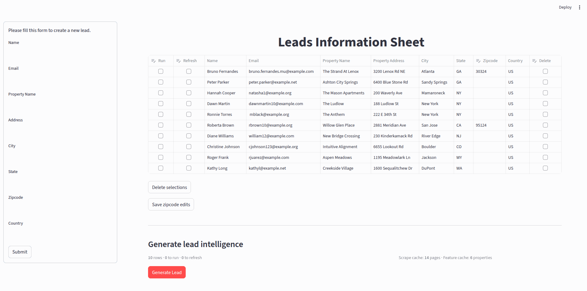
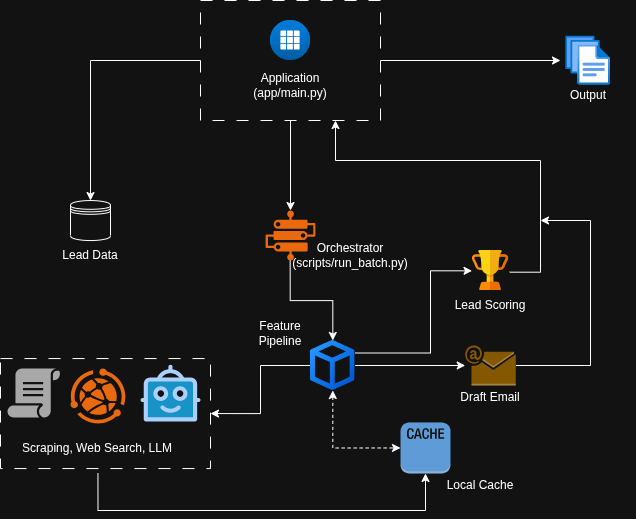

# LeadIntel — AI Lead Scoring for Property-Management Sales

LeadIntel turns a list of apartment-property leads into a ranked, explained sales pipeline. For every lead it researches the property across the web, scores how promising it is, explains *why*, and drafts a personalized outreach email, all in a Streamlit app.

It is built for a leasing-automation SaaS that sells to residential property managers. Outreach emails are written as a Sales Development Representative (SDR) at a configurable company; see [Company settings](#company-settings).

<p align="center">
  
</p>

---

## Features

**Research, done automatically for each property**
- **Apartments.com**: unit count, review count, 1–2 star complaints, management company
- **Zillow**: active listings and floorplan count
- **Account fit lookup** (Gemini + Google Search): manager portfolio size, property type and property-management software (PMS) vendor
- **Buying triggers** (Gemini + Google Search): ownership changes, lease-up / new construction, leasing-role hiring, expansion and tech changes from the last 18 months, with source URLs
- **U.S. Census**: population, housing units, median income, labor-force employment rate and occupancy for the ZIP code

**Scoring and outreach**
- A 0–100% **lead score**, a **priority bucket** (High / Medium / Low / Needs Review) and plain-English **reasons**
- A **score breakdown chart** on every lead showing the points each component earned out of its maximum
- An **AI-drafted outreach email** that uses only facts that were found, with one-click **Regenerate** and **Copy**
- A **Sources** section on every lead linking to the web pages behind its portfolio size, property type, PMS vendor and buying triggers

**Working with results**
- **Summary bar** with lead counts per bucket and the average score
- **Filter** by priority bucket and **sort** by score or property name
- **Download as CSV**: scores, breakdown, reasons, key facts and email for the leads on screen
- **Lead management**: add leads from the sidebar, edit ZIP codes inline, delete rows

**Cost control**
- Two local caches mean a lead is only researched once; re-running it is instant and free
- Third-party keys embedded in scraped pages are **automatically redacted** before caching, so the cache is safe to commit

---

## Architecture

<p align="center">
  
</p>

What happens to each lead (`scripts/run_batch.py` → `process_row`):

```
CSV row
  │
  ├─► Resolve ZIP code (from the CSV, or geocode the address with OpenStreetMap Nominatim)
  ├─► Census demographics for the ZIP code
  ├─► FeaturePipeline  (skipped if the lead is cached)
  │     ├─ Firecrawl search + scrape → Apartments.com, Zillow   (pages cached, keys redacted)
  │     ├─ Gemini 3.5 Flash-Lite → structured features, validated by Pydantic
  │     ├─ Gemini 3.5 Flash + Google Search → account fit lookup
  │     └─ Gemini 3.5 Flash + Google Search → buying triggers
  ├─► domain/scoring.py → score, bucket, breakdown, reasons   (always recomputed)
  └─► Gemini 3.5 Flash → outreach email
        │
        └─► features + email cached in data/lead_cache.json
```

---

## Tech stack

| Layer | Technology |
|---|---|
| UI | Streamlit, Altair charts |
| LLM | Google Gemini 3.5 Flash / Flash-Lite via LangChain (`langchain-google-genai`), with Google Search grounding |
| Web scraping | Firecrawl |
| Geocoding | geopy (OpenStreetMap Nominatim) |
| Demographics | U.S. Census Bureau APIs (2020 Census, 2024 American Community Survey) |
| Validation | Pydantic v2 |
| Data | pandas, local JSON caches |
| Config | python-dotenv |

---

## How leads are scored

All scoring rules live in [`domain/scoring.py`](domain/scoring.py), and the weights are defined once in `LEAD_SCORE_WEIGHTS`.

**Lead score** = weighted sum of five components, each scored 0–1:

| Component | Weight | What it measures |
|---|---|---|
| Account fit | 35% | Units at the property (20 → 500+), manager portfolio size (200 → 20,000+ units), property type |
| Operational complexity | 25% | Vacancy pressure (active listings ÷ units), floorplans, detected PMS vendor, review volume × complaint rate |
| Buying triggers | 20% | Ownership change, lease-up, hiring, expansion, tech change — more recent scores higher, scaled by evidence confidence |
| Market context | 10% | ZIP-level housing units, population, median income, employment rate (100 − unemployment), occupancy |
| Data confidence | 10% | Census coverage, whether the property was found online, share of lookups that succeeded |

**Priority bucket:**

| Condition | Bucket |
|---|---|
| Data confidence < 0.4 | Needs Review |
| Score ≥ 80% | High |
| Score ≥ 60% | Medium |
| Score ≥ 40% | Low |
| Otherwise | Needs Review |

Scores are recomputed from cached features on every run, so changing a weight or threshold takes effect immediately, with no API calls.

---

## Getting started

### Requirements

- Python 3.10+
- API keys for Google Gemini, Firecrawl and the U.S. Census (see below)

### 1. Clone and install

```bash
git clone https://github.com/pchourasia1/LeadIntel.git
cd LeadIntel

python -m venv .venv
source .venv/bin/activate        # Windows (Git Bash): source .venv/Scripts/activate
                                 # Windows (PowerShell): .venv\Scripts\Activate.ps1
pip install -r requirements.txt
```

### 2. Add your API keys

Create a `.env` file in the project root. It is git-ignored, so keys never get committed.

```env
GOOGLE_API_KEY=your-gemini-key
FIRECRAWL_API_KEY=your-firecrawl-key
CENSUS_API_KEY=your-census-key
```

| Key | Where to get it | Notes |
|---|---|---|
| `GOOGLE_API_KEY` | [Google AI Studio](https://aistudio.google.com/apikey) → **Create API key** | **Enable billing** on the key's project. The free tier blocks Google Search grounding, which leaves account fit and buying triggers empty. |
| `FIRECRAWL_API_KEY` | [firecrawl.dev](https://www.firecrawl.dev) → Dashboard → **API Keys** | New accounts get free credits. |
| `CENSUS_API_KEY` | [Census API key signup](https://api.census.gov/data/key_signup.html) | Free. Click the activation link in the email; activation can take a few minutes. |

The app reads `.env` at startup, so restart it after changing a key.

### Company settings

Outreach emails are written as a sales rep (SDR) at your company, and the "Why this score" reasons refer to it by name. Set these in `.env` (all optional):

```env
COMPANY_NAME=Acme Leasing
COMPANY_PITCH=an AI leasing assistant that answers prospects 24/7 and books tours
SENDER_NAME=Jordan
```

| Setting | Used in | Default |
|---|---|---|
| `COMPANY_NAME` | Email prompt and score reasons | `My Lease AI` |
| `COMPANY_PITCH` | Email prompt: "You are an SDR at {name}, {pitch}." | a SaaS that automates leasing communication for residential property managers (24/7 prospect follow-up, tour scheduling, lead nurturing) |
| `SENDER_NAME` | Email sign-off | `Prakash` |

Defaults live in [`settings.py`](settings.py). Reasons update on the next **Run**; cached emails keep the old wording until you **Regenerate** or **Refresh** them.

### 3. Run the app

From the project root:

```bash
streamlit run app/main.py
```

Open http://localhost:8501, then:

1. Review the leads table (pre-loaded from `data/sample_input.csv`) or add a lead from the sidebar.
2. Tick **Run** or **Refresh** on the leads to process (see below).
3. Click **Generate Lead**.
4. Use the summary bar, priority filter and sort to review the lead cards, and **Download as CSV** to export.

### Run vs. Refresh vs. Regenerate

| Action | What it does | API cost |
|---|---|---|
| **Run** | Uses cached features and email if the lead was processed before; otherwise runs the full pipeline | None for cached leads |
| **Refresh** | Deletes the lead's cached features and email, then researches it again (census, Gemini lookups, new email). Scraped pages stay cached. | Gemini + Census calls, no Firecrawl credits |
| **Regenerate** (on a lead card) | Drafts a new email from the cached features | One Gemini call |

Use **Refresh** after fixing a key or data source so a lead picks up the new data.

### Run without the UI

```bash
python -m scripts.run_batch
```

Prints a score for every lead in `data/sample_input.csv`.

---

## Input format

`data/sample_input.csv`:

| Column | Required | Notes |
|---|---|---|
| Name | ✓ | Lead's name |
| Email | ✓ | Lead's email |
| Property Name | | Used to find the property online; strongly recommended |
| Property Address | ✓ | Street address |
| City | ✓ | |
| State | ✓ | |
| Zipcode | | 5 digits; geocoded from the address if blank |
| Country | ✓ | e.g. `US` |

---

## Caching

| File | Contents | Cleared by |
|---|---|---|
| `data/scrape_cache.json` | Firecrawl search results and scraped page markdown | Deleting the file (or its entries) |
| `data/lead_cache.json` | Extracted features and drafted email per lead | **Refresh** on a lead, or deleting the file |

Both files are committed so the sample leads come with results. Before saving scraped pages, `clients/scrape_cache.py` redacts embedded third-party credentials (Google `AIza…` keys and long `key=` / `token=` / `signature=` URL parameters). To clean an older cache file, run:

```bash
python -c "from clients import scrape_cache; print(scrape_cache.redact_cache_file(), 'entries redacted')"
```

---

## Project structure

```
LeadIntel/
├── settings.py                     # Company name, pitch and sender (overridable in .env)
├── app/main.py                     # Streamlit UI: lead table, summary, filter, cards, chart, CSV export
├── scripts/
│   ├── run_batch.py                # Per-lead pipeline (process_row, redraft_email, run_batch)
│   └── misc.py                     # CSV schema enforcement
├── services/
│   ├── feature_pipeline.py         # Orchestrates enrichment and Gemini calls; model names live here
│   ├── enrichment/                 # Apartments.com, Zillow, account fit lookup
│   ├── email_drafter.py            # Outreach email generation
│   ├── prompts/buying_trigger.md   # Grounded-search prompt for buying triggers
│   ├── llm_utils.py                # JSON extraction from LLM replies
│   └── markdown_utils.py           # Section slicing for scraped pages
├── clients/
│   ├── firecrawl_client.py         # Search + scrape
│   ├── census_client.py            # Census APIs (needs CENSUS_API_KEY)
│   ├── scrape_cache.py             # Page cache with secret redaction
│   └── lead_cache.py               # Feature/email cache
├── domain/scoring.py               # Scoring model (pure Python, no I/O)
├── schemas/pydantic_schemas.py     # LLM output schemas
├── data/                           # Sample input + caches
└── assets/                         # README media
```

---

## Troubleshooting

| Symptom | Cause | Fix |
|---|---|---|
| `404 NOT_FOUND ... model is no longer available` | Google retired the Gemini model | Update the model names in `services/feature_pipeline.py` |
| Buying triggers and account fit are empty; log shows `429 RESOURCE_EXHAUSTED` | Google Search grounding isn't available on the free tier | Enable billing on the key's Google AI project, then **Refresh** the lead |
| Market context is 0; log says `Census API key missing or invalid` | No Census key, or it isn't activated | Add/activate `CENSUS_API_KEY`, restart the app, **Refresh** the lead |
| A lead shows *Needs Review* | Data confidence is below 0.4 (too many lookups failed) | Check the property name and address, then **Refresh** |

---

## Notes

- **Costs:** a new lead uses a few Firecrawl credits and several Gemini calls (two of them with Google Search). Cached leads cost nothing to re-run.
- **Scraping:** for research purposes only; respect the terms of service of the sites involved.
